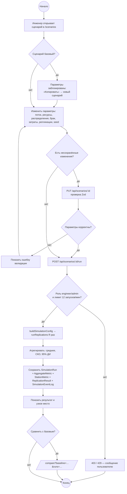

# UML: диаграммы деятельности

## Запуск моделирования (Scenario Studio → сервер)



## Поток изделия в модели (одна репликация)

```mermaid
flowchart TD
  ARR([ARRIVAL: задание поступило]) --> Q1[QUEUE_ENTER A1] --> P1[PROCESS_START/FINISH A1 Комплектация]
  P1 --> Q2[Очередь B1] --> P2[Мехобработка B1]
  P2 --> Q3[Очередь C1] --> P3[Сборка C1]
  P3 --> Q4[Очередь D1] --> P4[Испытания D1]
  P4 --> QC{QUALITY_CHECK:<br/>дефект с вероятностью p<br/>(p_retest после доработки)}
  QC -- годен --> Q6[Очередь E1] --> P6[Упаковка E1] --> DEP([DEPARTURE: отгружено])
  QC -- дефект, циклов &lt; max --> RW[REWORK → очередь D2 → доработка D2] --> Q4
  QC -- дефект, циклов = max --> SCR([SCRAP: списано])
  H{{HORIZON_END}} -. изделия в очередях и обработке .-> WIP([НЗП на конец горизонта])
```
