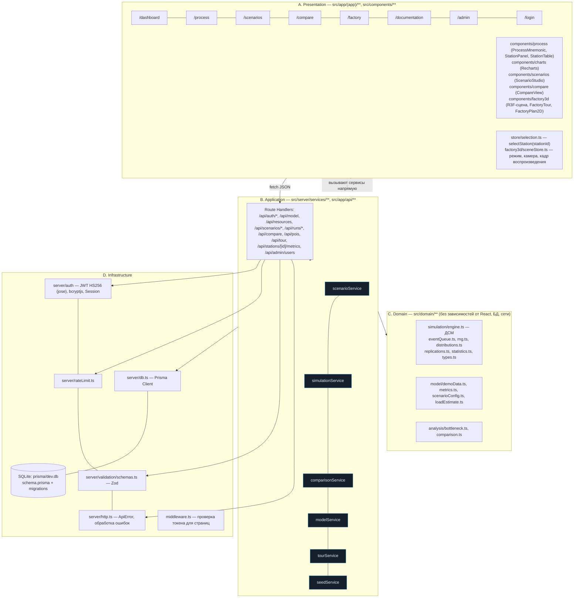

# Архитектура: слои и модули

Правило зависимостей: Presentation → Application → Domain; Infrastructure используется Application. Домен не импортирует ни React, ни Prisma; проверяется тем, что `tests/unit` выполняют движок без БД.
