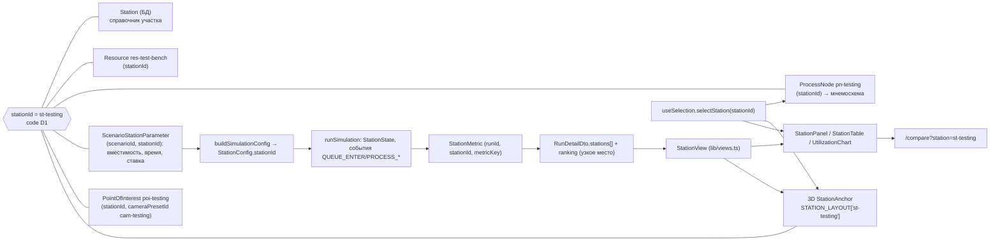

# Схема взаимодействия сущностей: единый `stationId`

Один и тот же идентификатор участка (например, `st-testing`) связывает все представления.

Карточки 3D-тура не содержат собственных данных: все числа берутся из `RunDetailDto` выбранного прогона (через `buildStationViews`) или из кадров `SimulationEventLog.snapshotsJson`.
