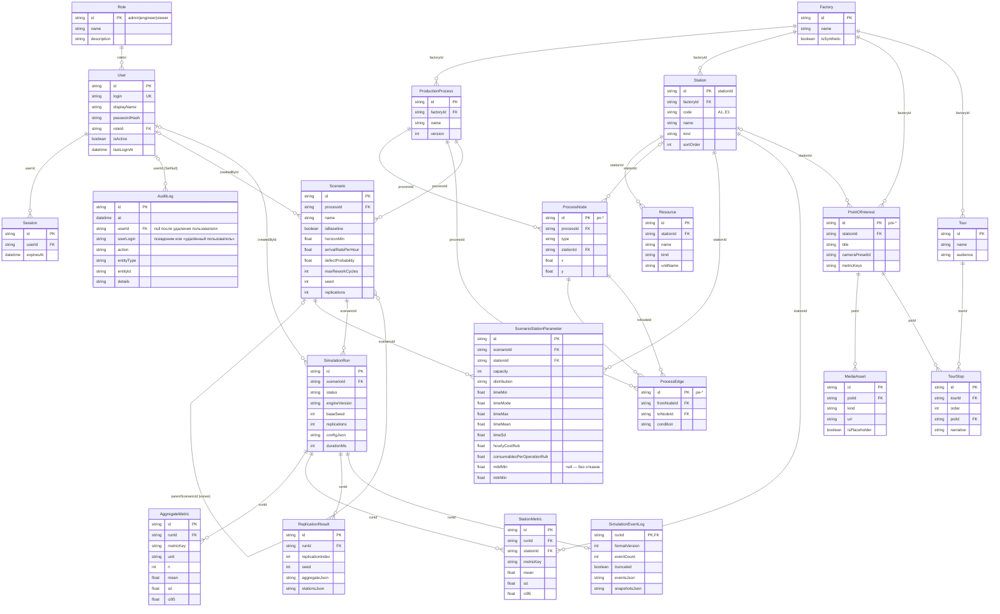

# ER-диаграмма (prisma/schema.prisma)

Уникальные ограничения: `User.login`; `Station(factoryId, code)`; `ScenarioStationParameter(scenarioId, stationId)`; `AggregateMetric(runId, metricKey)`; `StationMetric(runId, stationId, metricKey)`; `ReplicationResult(runId, replicationIndex)`; `TourStop(tourId, order)`.
