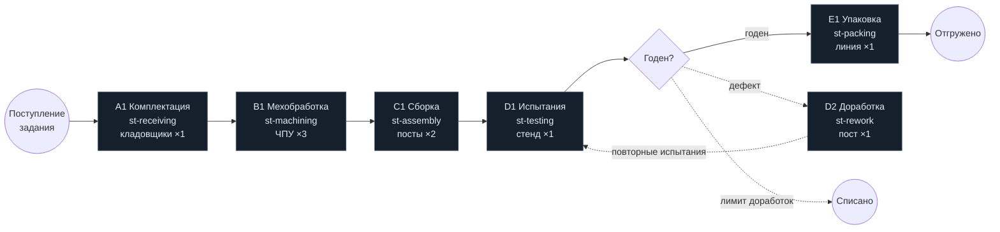

# Мнемосхема процесса

Интерактивная версия — страница `/process` (`src/components/process/ProcessMnemonic.tsx`), узлы показывают состояние, ресурс, производительность, очередь, стоимость и загрузку выбранного прогона.

Вместимость указана для базового сценария (синтетические данные). Цветовая индикация на странице: норма < 75%, высокая загрузка 75–90%, перегрузка ≥ 90% или накопление очереди (`src/domain/analysis/bottleneck.ts`).
