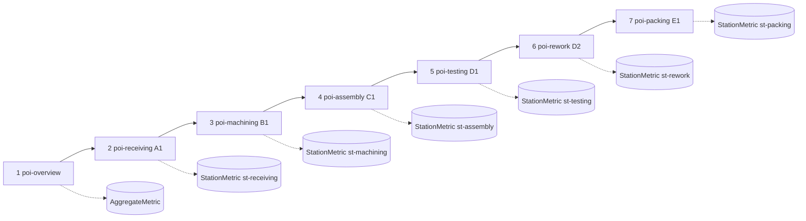

# Карта точек интереса 3D-тура

Координаты — система сцены (`src/components/factory3d/sceneContract.ts`): метры, Y вверх, X — по потоку изделия. Точки интереса и маршрут — `POINTS_OF_INTEREST`, `TOURS` в `src/domain/model/demoData.ts` (в БД: `PointOfInterest`, `Tour`, `TourStop`).

| Остановка | poiId | stationId | Код | Центр зоны (x, z) | Камера | Позиция камеры → цель | Метрики карточки |
|---|---|---|---|---|---|---|---|
| 1 | poi-overview | — | — | весь цех 70×36 м | cam-overview | (22, 30, 36) → (2, 0, 0) | completed, cycleTimeAvgMin, utilizationAvg |
| 2 | poi-receiving | st-receiving | A1 | (−26, −6) | cam-receiving | (−19, 8, 8) → (−26, 1.2, −5) | utilization, avgWaitMin, avgQueueLength |
| 3 | poi-machining | st-machining | B1 | (−11, −6) | cam-machining | (−4, 8, 8) → (−11, 1.2, −5) | utilization, avgQueueLength, throughputPerHour |
| 4 | poi-assembly | st-assembly | C1 | (3.5, −6) | cam-assembly | (10.5, 8, 8) → (3.5, 1.2, −5) | utilization, avgWaitMin, queueAtEnd |
| 5 | poi-testing | st-testing | D1 | (17, −6) | cam-testing | (24, 8, 8) → (17, 1.2, −5) | utilization, avgQueueLength, avgWaitMin |
| 6 | poi-rework | st-rework | D2 | (17, 11) | cam-rework | (23, 7, 23) → (17, 1.2, 12) | operationsCompleted, utilization, avgWaitMin |
| 7 | poi-packing | st-packing | E1 | (29.5, −6) | cam-packing | (24.5, 8, 8) → (29.5, 1.2, −5) | throughputPerHour, utilization, queueAtEnd |

Дополнительная камера без точки интереса: `cam-top` (2, 62, 6) → (2, 0, 2) — план сверху.

Каждая точка интереса связана с кейсом «лучшей практики» (поле `bestPractice`, кроме обзорной и отгрузки) и переходами: «На мнемосхеме» (`/process?station=…`), «Сравнить сценарии по участку» (`/compare?station=…`).
