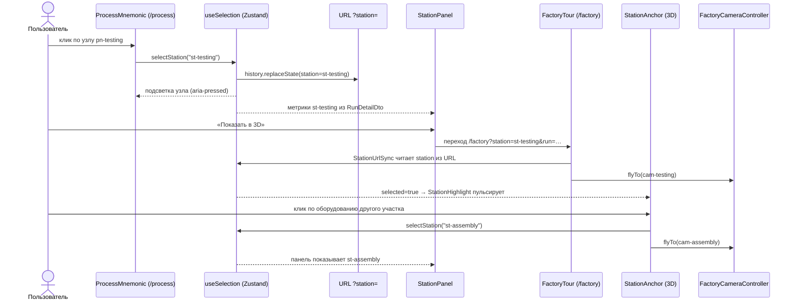

# UML: диаграммы последовательности

## Запуск моделирования

```mermaid
sequenceDiagram
  autonumber
  actor U as Инженер
  participant UI as ScenarioStudio (React)
  participant R as POST /api/scenarios/[id]/run
  participant Auth as requireUser (session.ts)
  participant RL as simulationLimiter
  participant SS as scenarioService.getScenario
  participant SIM as runScenarioSimulation
  participant ENG as runReplications / runSimulation
  participant DB as Prisma + SQLite

  U->>UI: «Запустить моделирование»
  opt есть несохранённые изменения
    UI->>DB: PUT /api/scenarios/[id] (Zod) → update
  end
  UI->>R: POST (cookie it_session)
  R->>Auth: проверить JWT, Session в БД, право simulation:run, Origin
  Auth->>DB: session.findUnique
  Auth-->>R: CurrentUser
  R->>RL: check(userId) — 12 запусков / 60 с
  alt лимит превышен
    R-->>UI: 429 RATE_LIMITED
  end
  R->>SIM: runScenarioSimulation(id, userId)
  SIM->>SS: getScenario(id)
  SS->>DB: scenario + stationParameters
  SS-->>SIM: ScenarioParameters
  SIM->>ENG: buildSimulationConfig → R репликаций (seed, deriveSeed)
  ENG-->>SIM: aggregate/stations SummaryStats, журнал репликации №1
  SIM->>DB: create SimulationRun + AggregateMetric + StationMetric + ReplicationResult + SimulationEventLog (одна операция)
  SIM->>DB: getRunDetail(runId)
  SIM-->>R: RunDetailDto (+ ranking, bottleneck)
  R-->>UI: 201 { run }
  UI->>UI: router.refresh(); показать результат и ссылку «Сравнить с базовым»
```

## Синхронизация выбора участка (selectStation)


