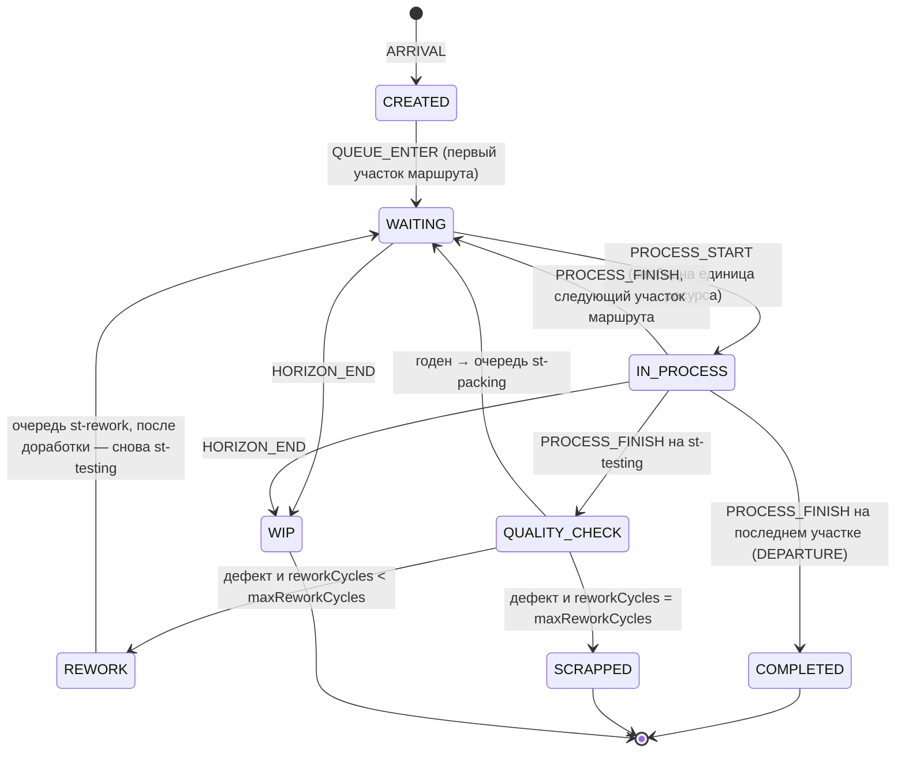
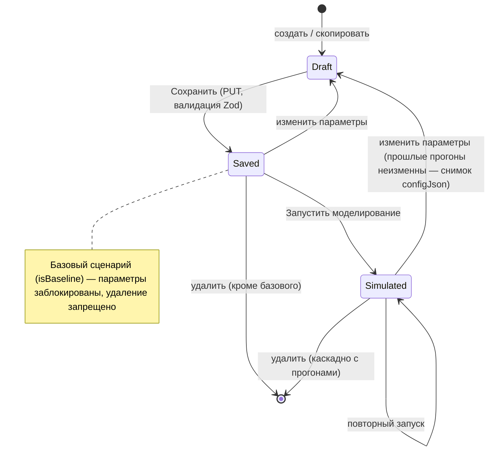
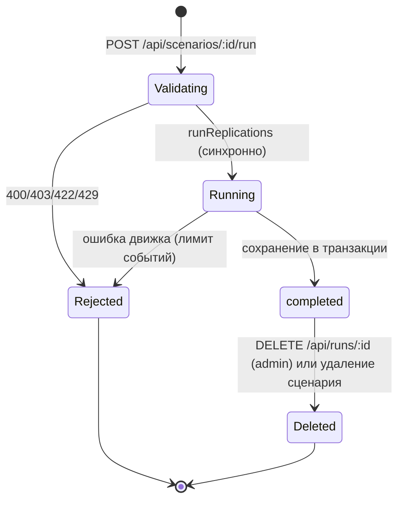

# UML: диаграммы состояний

## Изделие (UnitState в src/domain/simulation/engine.ts)

Итоговые исходы `UnitOutcome`: `COMPLETED`, `SCRAPPED`, `WIP`.

## Сценарий

## Прогон моделирования (SimulationRun.status)

Статус `failed` предусмотрен схемой, но текущая реализация не сохраняет неуспешные прогоны: ошибка возвращается клиенту.
