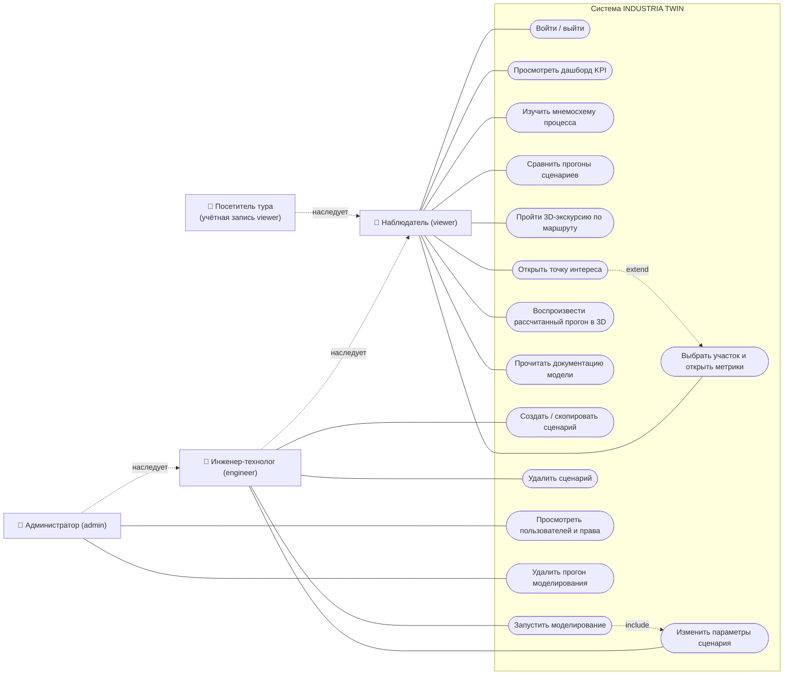

# UML: варианты использования

Mermaid не имеет нативной нотации use case, поэтому диаграмма построена средствами `flowchart`: акторы — прямоугольники слева, варианты использования — овалы (stadium) внутри границы системы, наследование ролей — пунктир «наследует». Права соответствуют `src/server/auth/permissions.ts`.

